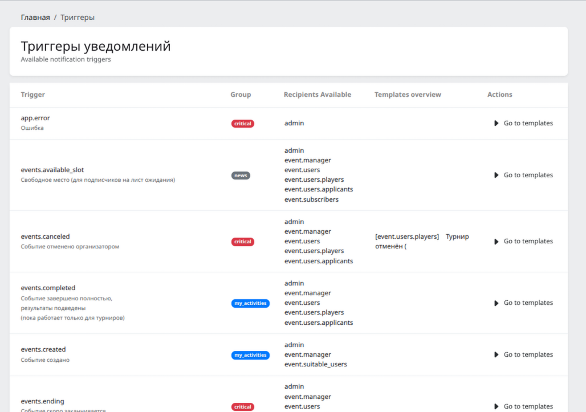
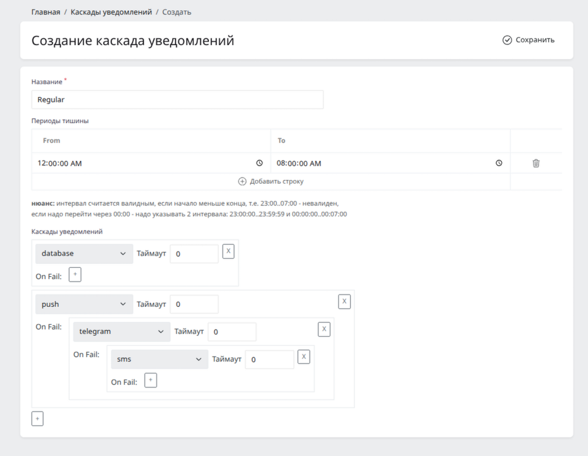
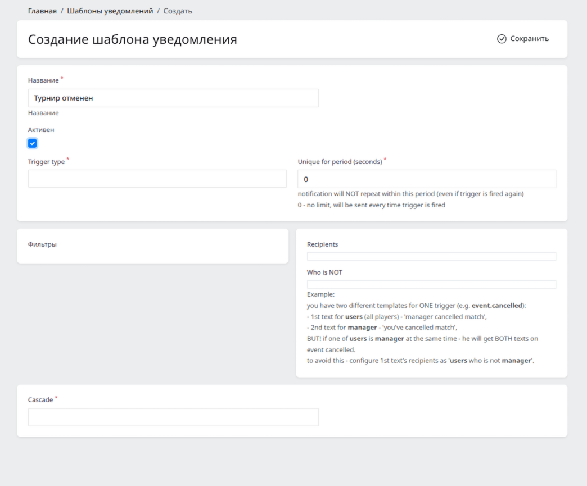
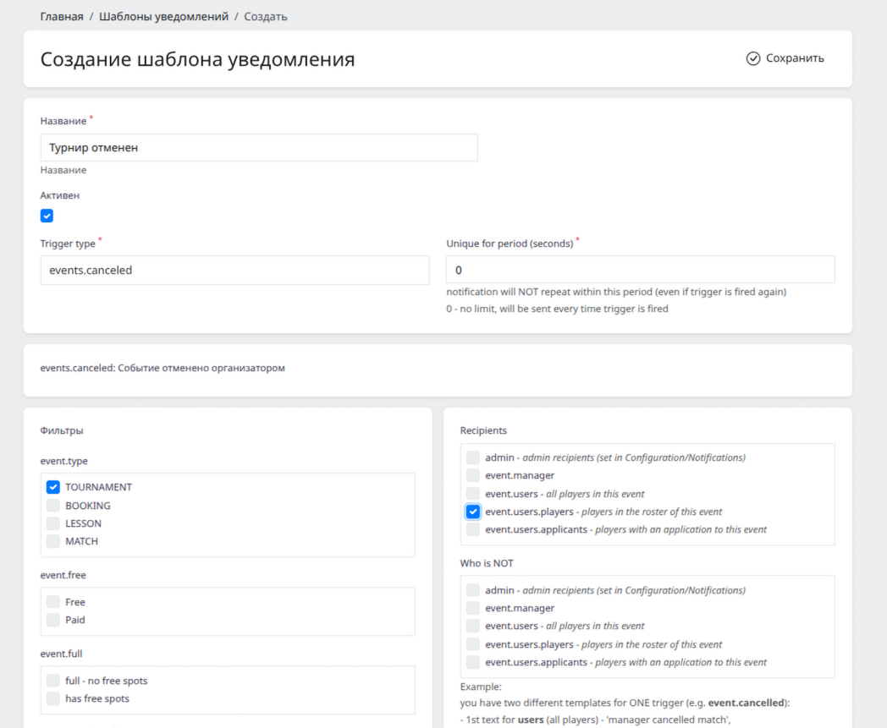
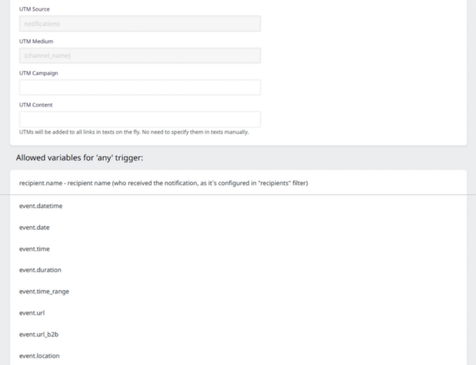
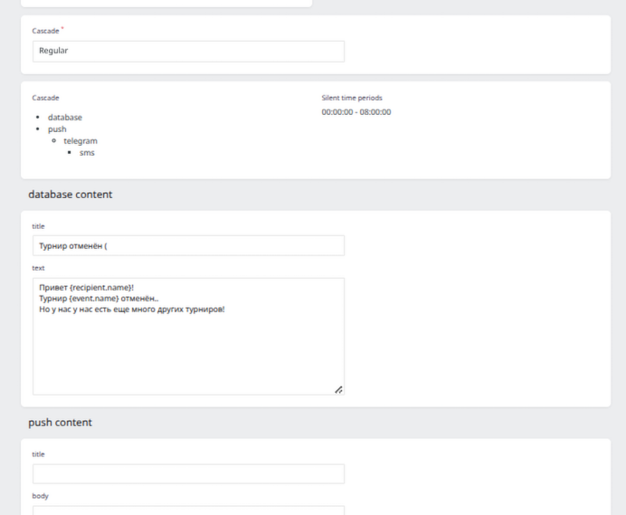
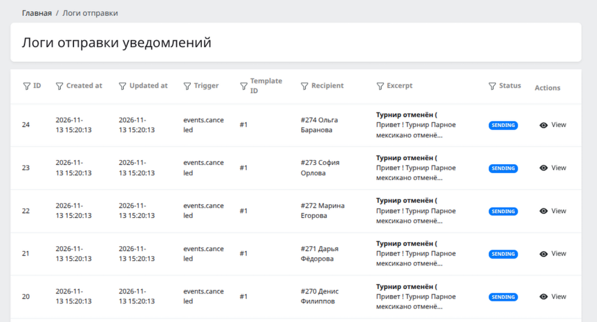
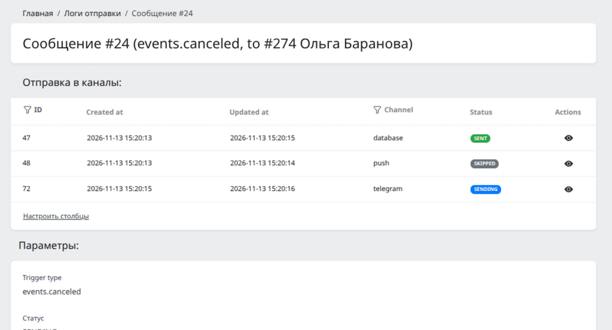

# Триггерные уведомления — фрагмент кода

Фрагмет кода подсистемы уведомлений из проекта на Laravel 11. 

Опубликован с согласия правообладателя **ИСКЛЮЧИТЕЛЬНО** в целях демонстрации компетенций разработчика, намеренно НЕ оформлен как рабочий код. Использование представленного кода в иных целях - строго запрещено.

Система пришла на смену стандартным Laravel's нотификациям (в которых логика и текст зашиты в коде).

## Особенности примера

- код вырезан из рабочего проекта исключительно для ознакомления с кодом, и намеренно НЕ оформлен как рабочий проект;
- задача реализована "руками", с минимальным участием AI (на тот момент, для задач, существенно меняющих архитектуру, я предпочитал Cursor autocomplete);
- код демонстрируется as is, со всеми отложенными доработками, техдолгом и TODO-каментами в коде (это **живой пример работы** в живом проекте с необходимостью распределять приоритеты);
- проект изначально написан модульно, но с избыточными связями между модулями (в частности - модели часто передаются в ДТО для ускорения работы, и т.п.); данный пример осознанно это не исправляет и следет сложившейся в проекте практике (это тоже пример работы на живом проекте с его сложившейся практикой);

**Задача**

Создать гибко настраиваемую систему триггерных рассылок, в которой админ сможет настраивать в админке шаблоны сообщений для различных событий в системе.

Цели - дать админу возможность настраивать в админке:
- шаблоны сообщений на любые события (триггеры); в тексте шаблона используются переменные (в зависимсти от выбранного триггера);
- получателей, кому отправлять;
    - например, при событии "турнир отменен" мы хотим отправлять разные сообщения организатору события, участникам события, а также заявителям, которые подали заявку, но еще не были утверждены в состав.. или кому-то не хотим отправлять;
- условия, при которых сообщение отправляется;
    - например, сообщение может быть настроено для турниров только определенного типа, или для турниров с платным/бесплатным участием, и т.п.;
- каскады отправки по каналам. 
    - например:
        - срочная отправка: каскад с отправкой во все каналы сразу (пуш, тг, почта, смс, ...)
        - обычная отправка: отправляем push, если недоставлено - отправляем в ТГ, если неудачно - то в смс.. параллельно - всегда отправляем в почту;
    - каскады настраиваются из админки произвольно, и шаблон сообщения подключается к каскаду.
    - там же настраиваются тихие часы и кулдаун-период:
        - тихие часы - например, если попытка отправки пришлась на тихие часы - она откладывается до утра;
        - кулдаун - например, это сообщение можно отложить на 10 минут, если в последние 5 минут было другое сообщение (чтобы не спамить сильно часто);

## Базовая архитектура

### Настройка

1. **Разработчик описывает триггеры:** каждый триггер - это отдельное событие системы; описывает доступные переменные, группы получателей и фильтры. При наступлении события вызывает NotificationTrigger::fire(new SomeTrigger(...)); пример — [EventAvailableSlotTrigger](triggers/app/Modules/Notification/V1/NotificationTriggers/Event/EventAvailableSlotTrigger.php).
2. **Админ создает [каскад отправки](./app/Modules/Notification/V1/ValueObjects/NotificationChannelCascade.php#L12):** например, отправить push, при неудаче отправить Telegram, при неудаче отправить SMS.
3. **Админ создает [шаблон сообщения](./app/Orchid/Layouts/NotificationTemplate/NotificationTemplateEditContentLayout.php#L131):** выбирает триггер и каскад, задает тексты для каналов каскада с переменными триггера, настраивает фильтры и получателей;
4. **Админ просматривает логи отправки** в админке в наглядном виде (кому какое соощение в какой канал пришло, в какой не пришло и по какой причине);

### Обработка триггера

Структура хранения сообщений
- Сообщение (Message) - это интент на отправку сообщения юзеру; хранит отрендеренный текст для всех каналов;
- Отправления (Delivery) - это отправка соощения в один из каналов в рамках Message и его каскада;

Цепочка обработки триггера: 
1. **Вызов триггера** в коде NotificationTrigger::fire(new SomeTrigger(...)), например [EventCreatedListener](./app/Modules/Notification/V1/Listeners/EventCreatedListener.php#L18);
2. **Создание сообщений** [NotificationTriggerService](./app/Modules/Notification/V1/Services/NotificationTrigger/NotificationTriggerService.php#L87) подбирает подходящие шаблоны, определяет получателей, рендерит тексты, и создает Сообщения (NotifiationMessage).
2. **Обработка Сообщений.** [NotificationMessageProcessor](./app/Modules/Notification/V1/Services/NotificationMessage/NotificationMessageProcessor.php#L48) анализирует состояние отправки Отправления (Delivery) Сообщения (Message) по его Каскаду и, при необходимости, создает следующее Отправление (Delivery).
3. **Обработка Отправлений.** [NotificationDeliveryProcessor](./app/Modules/Notification/V1/Services/NotificationDelivery/NotificationDeliveryProcessor.php#L36) анализирует состояние Отправления (Delivery) и при необходимости делает попытку отправки через нужный канал. При изменении статуса Отправления (Delivery) заново запускается NotificationMessageProcessor и анализирует состояние Сообщения (Message);

## Тестирование
Фасад NotificationTrigger предоставялет фейкер:
- инициализируется с помощью [NotificationTrigger::fake()](./app/Modules/Notification/V1/Facades/NotificationTrigger.php#L44) (в частности, можно зафейкать только определенные триггеры);
- ассертится с помощью [assertFired](./app/Modules/Notification/V1/Tests/Fakers/NotificationTriggerServiceFaker.php#L28)/[assertNotFired()](./app/Modules/Notification/V1/Tests/Fakers/NotificationTriggerServiceFaker.php#L62).

Примеры тестов:
- [EventCreatedListenerTest](./app/Modules/Notification/V1/Tests/Integration/Listeners/EventCreatedListenerTest.php#L16) — использование фейкера в тесте листенера.
- [ComplexNotificationE2ETest](./app/Modules/Notification/V1/Tests/Integration/ComplexNotificationE2ETest.php#L37) — полный цикл отправки по каскаду.
- [NotificationDeliveryProcessorTest](./app/Modules/Notification/V1/Tests/Integration/NotificationDeliveryProcessorTest.php#L56) — обработка доставок.
- [EventUpcomingTriggerTest](./app/Modules/Notification/V1/Tests/Integration/Triggers/EventUpcomingTriggerTest.php#L20) — фильтры триггера.

## Точки расширения

### Новые триггеры

Триггер реализуют [контракт Trigger](./app/Modules/Notification/V1/NotificationTriggers/Trigger.php#L46); контракт задан базовым классом;

- **Тип и регистрация.** основное - зарегистрировать триггер в провайдере, указать ему type() и корректно зарегистрировать соответствующий тип и привязать его к группе (за консистентностью регистрации следит [TriggersConsistencyTest](./app/Modules/Notification/V1/Tests/Integration/Triggers/TriggersConsistencyTest.php#L16));
- **Переменные, получатели, фильтры.** [recipients()/excludedRecipients()](./app/Modules/Notification/V1/NotificationTriggers/Trigger.php#L71), [filters()](./app/Modules/Notification/V1/NotificationTriggers/Trigger.php#L103)/[applyFilters()](./app/Modules/Notification/V1/NotificationTriggers/Trigger.php#L155), [variables()](./app/Modules/Notification/V1/NotificationTriggers/Trigger.php#L124)
- **Дополнительные настройки.** [uniqueIdData()](./app/Modules/Notification/V1/NotificationTriggers/Trigger.php#L180)/[uniqueIdTtl()](./app/Modules/Notification/V1/NotificationTriggers/Trigger.php#L195) - обеспечение идемпотентности отправки;задают защиту от повторов, [isStillFired()](./app/Modules/Notification/V1/NotificationTriggers/Trigger.php#L164) — проверку актуальности перед отправкой, [queue()](./app/Modules/Notification/V1/NotificationTriggers/Trigger.php#L200) — очередь. 
- **Метаданные для админки.** Метод [Trigger::empty()](./app/Modules/Notification/V1/NotificationTriggers/Trigger.php#L24) создает экземпляр с null во всех аргументах конструктора. Конструктор и методы, описывающие триггер, должны работать без данных события.

примеры
- простейший триггер — [EventCancelledTrigger](./app/Modules/Notification/V1/NotificationTriggers/Event/EventCancelledTrigger.php#L8)
- комплексный триггер — [EventUpcomingTrigger](./app/Modules/Notification/V1/NotificationTriggers/Event/EventUpcomingTrigger.php#L11)

### Новые каналы
- каналы имплементируют интерфейс [ChannelInterface](./app/Modules/Notification/V1/Notifications/Channels/ChannelInterface.php#L8)
    - пример простейшего канала — [SmsChannel](./app/Modules/Notification/V1/Notifications/Channels/SmsChannel.php#L12)

## Основные known-issues
- основные бизнес-задачи, которые были отложены как менее приоритетные:
    - реализовать параллельную обработку воркерами для ускорения рассылок (сначала требуется доп.защита [здесь](./app/Modules/Notification/V1/Jobs/FireNotificationTriggerJob.php#L26) и [здесь](./app/Modules/Notification/V1/Services/NotificationTrigger/NotificationTriggerService.php#L308));
    - реализовать анализ более "глубоких" статусов отправки (сейчас все заканчивается на "отправлен", в будущем предполагалась обработка "доставлен", "прочитан" и тп., в зависимости от выбранного канала отправки (смотря что он поддерживает));
- архитектурные недочёты, отложенные в техдолг:
    - неудачная связь определния финальных статусов доставки с [Отправлением, а не Каналом](./app/Modules/Notification/V1/Enums/NotificationDeliveryStatusEnum.php#L16); в частности, это первое, что надо сделать при реализации обработки "глубоких" статусов;
    - часть структур в контракте триггера хранится в массиве, по ходу разработки усложнилась.. есть желание перевести на типизированную структуру VO:
        - описание доступных фильтров [лучше перевести на типизированные VO](./app/Modules/Notification/V1/NotificationTriggers/Trigger.php#L98).
        - [описание получателей и переменных](./app/Modules/Notification/V1/NotificationTriggers/Trigger.php#L58).
    - описание триггера смешано с экземпляром триггера, изза этого родился [костыль "empty()"](./app/Modules/Notification/V1/NotificationTriggers/Trigger.php#L17).
    - легаси-структура каналов [устарела и выглядит переусложненной](./app/Modules/Notification/V1/Services/NotificationChannel/NotificationChannelService.php#L22)
        - в частности, изза этого родился [костыль для унификации возврата статуса отправки](./app/Modules/Notification/V1/Services/SenderServiceInterface.php#L9); он сделан как временное решние поверх существующей архитектуры, и просит рефактора;

### Устройство админки
- [Триггеры](./app/Orchid/Screens/NotificationTrigger/NotificationTriggerListScreen.php#L20) - список доступных триггеров, их получателей и настроенных шаблонов; дает пользователю обзор "какие триггеры использованы, а какие нет";
- [Каскады](./app/Orchid/Screens/NotificationCascade/NotificationCascadeListScreen.php#L17) - список, создание и редактирование каскадов отправки;
- [Шаблоны](./app/Orchid/Screens/NotificationTemplate/NotificationTemplateListScreen.php#L18) - список, создание и редактирование шаблонов; форма динамическая (используются Orchid's Listeners - вшитый механизм зависимости части формы от введенных данных):
    - выбор триггера (определяет, какие будут доступны получатели, фильтры и переменные);
    - выбор каскада (определяет, для каких каналов предлагается заполнить текст);
    - также при сохранении валидирует текст сообщения на корректность переменных (все ли доступны для данного триггера, все ли корректно парсятся);
- [Логи отправки](./app/Orchid/Screens/NotificationMessage/NotificationMessageListScreen.php#L13) - список Сообщений (Message) с получателями и статусами (3 уровня - список сообщений, форма сообщения со списком его отправлений, форма отправления с логами апи-вызовов);
[см. иллюстрации](#иллюстрация-работы-админки)

## Приложенные изображения

### иллюстрация работы админки

&emsp;&emsp;&emsp;

&emsp;&emsp;&emsp;

